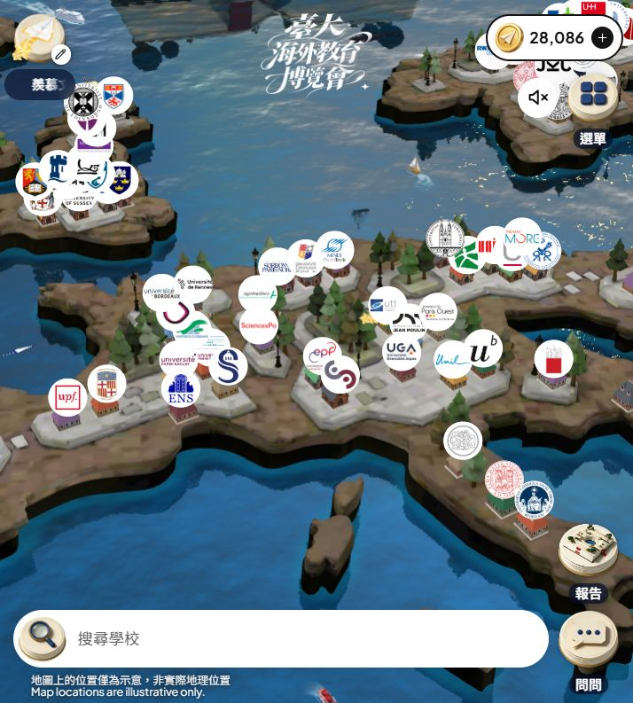
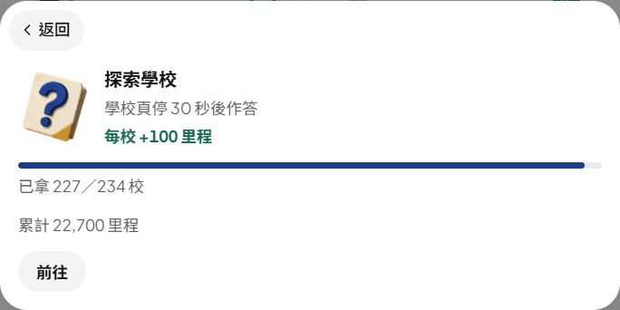

<div align="center">

# NTU Study Abroad Expo

**留學選校研究・作答紀錄・Agent 交接手冊**

把展會網站的學校探索整理成可查證、可延續的研究紀錄，讓下一位 Codex 或 Claude 能直接接手。

</div>



<div align="center"><sub>登入中的歐洲地圖全畫面 · 2026-11-01</sub></div>

---

## 目前進度

| 學校圖鑑 | 探索學校獎勵 | 答題紀錄 | 飛行里程 |
|:---:|:---:|:---:|:---:|
| **289 / 289** 已瀏覽 | **227 / 234** 已取得 | **227 對 · 5 錯** | **28,086** |

> 最近一次紀錄：2026-11-01。這些數字是當時截圖與筆記記下的狀態；接手時請先到登入中的網站確認最新進度。圖鑑瀏覽數和答題獎勵數是不同項目。

### 探索學校任務

網站目前記錄 **227 / 234 校**，累計取得 22,700 里程。



## 從這裡開始

### 新接手的 Agent

1. 先讀 **[Agent 交接指南](AGENT-HANDOFF.md)**，了解使用者背景、目前狀態和操作原則。
2. 查 **[已核實答案索引](verified-answer-index.md)**，再跟到原始紀錄閱讀題目與證據。
3. 需要選校建議或完整題目紀錄時，讀 **[個人背景、選校清單與完整紀錄](profile-and-shortlist.md)**。

### 按用途找資料

| 想做什麼 | 看哪份文件 |
|---|---|
| 快速了解怎麼接手、哪些限制要注意 | [AGENT-HANDOFF.md](AGENT-HANDOFF.md) |
| 搜尋曾答對的題目選項 | [verified-answer-index.md](verified-answer-index.md) |
| 了解適合使用者的學校與申請條件 | [profile-and-shortlist.md](profile-and-shortlist.md) |
| 查原題、選項、來源和網站判定 | [profile-and-shortlist.md](profile-and-shortlist.md) |

## 作答原則

- 先記下完整題目和所有選項，再查 NTU 學校介紹或學長姐心得中的直接證據。
- 每校可能只有一次作答機會；來源不夠明確時先不送出。
- 答案索引是查找入口，不是脫離題目脈絡的答案清單。以原始紀錄和網站當下題目為準。
- 學校名額、語言門檻、課程開放和住宿規定會變動；提供選校建議前要重查當年度官方資訊。

## 資料結構

```text
study-abroad-notes/
├── README.md                   # 專案入口與目前進度
├── AGENT-HANDOFF.md            # 給 Codex / Claude 的接手說明
├── verified-answer-index.md    # 網站明確判答對的答案索引
├── profile-and-shortlist.md    # 使用者背景、選校分析、題目證據與完整活動紀錄
└── assets/
    ├── expo-overview.jpg       # 歐洲學校圖鑑全畫面（2026-11-01）
    └── expo-progress.jpg       # 探索學校任務進度卡（2026-11-01）
```

## 進度缺口

目前仍差 **7 筆探索學校獎勵**：已知 5 間是用掉一次機會的錯答，另外 2 間校名尚未從紀錄中確認。已知錯答與網站公布答案列在 [交接指南](AGENT-HANDOFF.md) 和 [答案索引](verified-answer-index.md)；不要根據過期的「跳過數」猜剩下兩間。
